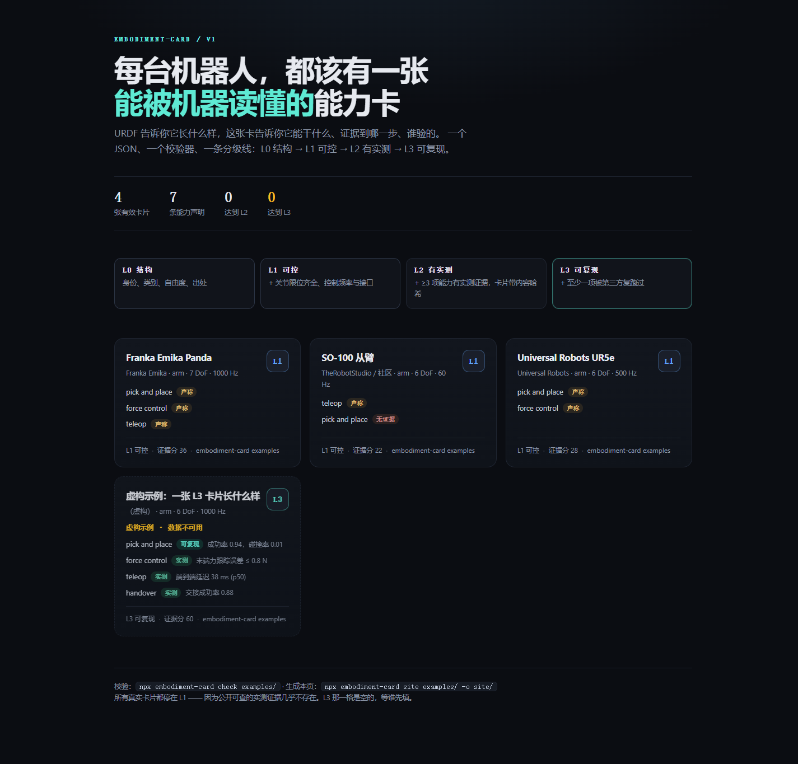

# Embodiment Card

**每台机器人，都该有一张能被机器读懂的能力卡。**

[](./schema/embodiment-card.v1.json)
[](https://github.com/13717930620-alt/embodiment-card/actions/workflows/ci.yml)
[](./LICENSE)
[](./package.json)
[](./package.json)
[](./CONTRIBUTING.md)

URDF 告诉你它长什么样，这张卡告诉你**它能干什么、证据到哪一步、谁验的**。

一个 JSON、一个零依赖校验器、一条四级分级线。

```bash
npx embodiment-card check examples/
```

```
✓ franka-panda-7dof   L1 可控   证据分 36
✓ so100-follower-6dof L1 可控   证据分 22
✓ ur5e-6dof           L1 可控   证据分 28
✓ fictional-l3-demo   L3 可复现 证据分 60
4 张卡片，4 通过，0 不通过
```

---

## 为什么需要这个

现在的机器人生态里，关于"这台本体能做什么"，有三种东西，都不够用：

| 现有形态 | 能回答 | 回答不了 |
|---|---|---|
| URDF / MJCF | 几何、惯量、关节树 | 能不能抓、能不能走、精度多少 |
| 模型卡（Model Card） | 模型训练数据与评测 | 换一台本体还成不成立 |
| 厂商 PDF / 官网 | 卖点 | 机器读不了，也没法 diff、没法校验 |

结果就是：每换一台本体，集成方都要重新问一遍同样的问题——**自由度多少、限位在哪、能不能实时、谁验过、验到什么程度**。答案散在 PDF、聊天记录和某个同事的记忆里。

Embodiment Card 把这些压成一份可校验、可 diff、可分级的结构化文档。

---

## 分级：这张卡片能背多少责任

分级不评价机器人好不好，只评价**这张卡片背后的证据强度**。

| 等级 | 要求 | 意味着 |
|---|---|---|
| **L0 结构** | 身份、类别、自由度、出处齐全 | 知道有这台东西 |
| **L1 可控** | + 关节限位齐全、控制频率与接口已声明 | 可以写控制代码 |
| **L2 有实测** | + 至少 3 项能力有 `measured` 证据，卡片带内容哈希 | 可以写进采购评审 |
| **L3 可复现** | + 至少 1 项能力被第三方复跑过 | 可以写进合同 |

> **现状：本仓库 3 张真实示例卡片全部停在 L1。**
> 不是偷懒，是因为公开可查的实测证据几乎不存在——厂商给的是"重复定位精度 ±0.1mm"这类孤立指标，不是"这台机器人在这个任务上成功率多少"。
> L3 那一格现在是空的。这是留给第一个认真填的人的。

---

## 一张卡片长什么样

```json
{
  "schema": "embodiment-card/v1",
  "id": "franka-panda-7dof",
  "name": "Franka Emika Panda",
  "category": "arm",
  "dof": 7,
  "joints": [
    { "name": "panda_joint1", "min": -2.8973, "max": 2.8973, "unit": "rad", "velocityMax": 2.175 }
  ],
  "control": { "rateHz": 1000, "interfaces": ["fci", "ros2"], "realtime": true },
  "capabilities": {
    "pick_and_place": { "level": "claimed", "evidence": "厂商手册" },
    "force_control":  { "level": "measured", "evidence": "本厂标定", "metric": "力跟踪误差 ≤ 0.8 N" }
  },
  "provenance": {
    "source": "厂商公开数据表",
    "verifiedBy": "acme-robotics",
    "verifiedAt": "2026-11-14",
    "hash": "sha256:..."
  }
}
```

四个字段承担了全部语义：

- `joints` — 限位是**硬约束**，不是建议值。校验器会检查 `min < max`、自由度与关节数一致、关节名不重复。
- `control` — 控制频率和接口决定这台本体能不能进你的闭环。
- `capabilities` — 键是能力名，值是证据等级 + 可复算的指标。`none < claimed < measured < reproduced`。
- `provenance` — 谁验的、什么时候、内容哈希。哈希让卡片可被钉住，防止"审的时候是一版、交付是另一版"。

完整规范见 [`schema/embodiment-card.v1.json`](./schema/embodiment-card.v1.json)。

---

## 用法

### CLI

```bash
npx embodiment-card check examples/                 # 校验 + 评级
npx embodiment-card check examples/ur5e-6dof.json   # 单张
npx embodiment-card site  examples/ -o docs/        # 生成静态卡片墙
npx embodiment-card init  my-robot                  # 打印最小骨架
```

退出码 `0` 全通过、`1` 有错误、`2` 用法错误，可直接接进 CI。

### 作为库

```js
import { validate } from 'embodiment-card';
import { grade } from 'embodiment-card/grade';

const v = validate(card);
if (!v.ok) throw new Error(v.errors.map(e => `${e.path}: ${e.msg}`).join('\n'));
console.log(grade(card).label); // "L1 可控"
```

零运行时依赖，Node ≥ 18。

---

## 卡片墙

`docs/index.html` 是渲染出来的静态页，纯 HTML + 内联 CSS，没有构建步骤、没有外部请求，可以直接丢到任何静态托管：



自己生成：`npx embodiment-card site examples/ -o docs/`

在线版：**https://13717930620-alt.github.io/embodiment-card/**

---

## 提交你的机器人

1. 复制 `npx embodiment-card init <id> > examples/<id>.json`
2. 填 `joints`（**照抄厂商数据表，不要凭手感估**）
3. 有实测就写 `measured` 并给 `metric`；没有就老实写 `none`
4. `npx embodiment-card check examples/` 全绿
5. 提 PR，附上证据链接（数据表 / 论文 / 你自己的复现记录）

审 PR 时只看两件事：**数字有没有出处，等级有没有虚标**。虚标等级比没有卡片更糟。

---

## 设计取舍

**为什么不用 JSON Schema 库做校验？**
规范只有 40 个字段，手写校验器 200 行、零依赖、报错信息可控。引入 ajv 会让"装一下试试"变成一次 `npm install`。

**为什么不做成 URDF 的扩展？**
URDF 是几何描述，塞进能力声明会让两个工具链互相绑架。卡片引用 URDF，不替代它。

**为什么没有 `score` 排名？**
分数只用于排序，不用于评价机器人优劣。一台便宜的 6 轴臂在你的任务上可能比七轴人形更合适——那由任务决定，不由卡片决定。

**为什么不收录模型权重？**
卡片描述**本体**。模型是另一张卡的事（那是 Model Card 的地盘）。两者通过 `capabilities.metric` 里的指标衔接。

---

## 现状与边界

- 本仓库是**规范 + 工具**，不是一个认证机构。L2 / L3 的判定依据是提交者提供的证据，我们只校验格式与自洽，不校验真伪。
- 示例卡片里的限位来自公开数据表；`fictional-l3-demo` 是**虚构数据**，只用来演示 L3 的字段形态，页面上明确标了"虚构示例"。
- 分级线是 v1 的约定，会随使用反馈调整。改分级线需要走 RFC（见 `CONTRIBUTING.md`）。

## 路线图

- [ ] `ec diff a.json b.json` —— 两台本体逐字段对比
- [ ] `ec render --png` —— 卡片导出为图片，方便贴进方案书
- [ ] GitHub Action：PR 里自动跑 `check` 并评论分级结果
- [ ] 官方 registry 页面（按能力检索：谁能做 0.1mm 级插装）
- [ ] `capabilities` 受控词表 v1（现在允许自由命名，容易各说各话）

## 许可

MIT。规范文本与代码同许可，鼓励实现与再分发。
